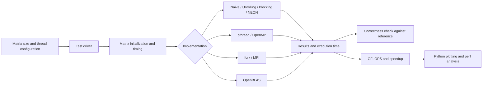
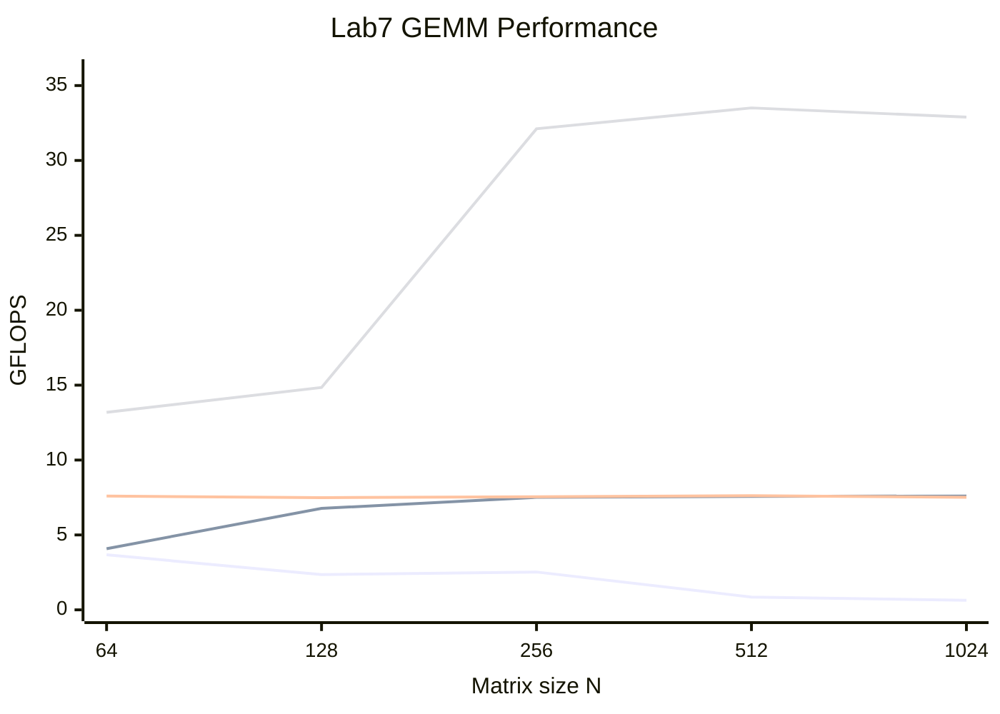

<div align="center">

<h1>High Performance Computing</h1>
<h3>High Performance Computing Application Practice · Fall 2026</h3>
<p>From naive matrix multiplication to parallel computing and single-core optimization</p>


<p><strong>English</strong> · <a href="README.zh-CN.md">简体中文</a></p>

</div>

This repository contains the source code for Labs 1–9 of the **High Performance Computing Application Practice** course. Double-precision matrix multiplication (DGEMM) is the common workload for exploring compiler optimization, multiprocessing, multithreading, OpenMP, MPI, performance analysis, and single-core optimization.

## Laboratory Overview

| Lab | Topics | Source directory |
| --- | --- | --- |
| Lab1 | Linux C programming, naive DGEMM, OpenBLAS, and memory layouts | [Lab1/lab1](Lab1/lab1) |
| Lab2 | Floating-point arithmetic, compiler optimization, and C/Python/NumPy/OpenBLAS comparisons | [Lab2](Lab2) |
| Lab3 | Multiprocessing with fork and matrix multiplication | [Lab3](Lab3) |
| Lab4 | pthread creation, argument passing, and blocked matrix multiplication | [Lab4](Lab4) |
| Lab5 | OpenMP parallel loops, scheduling, and matrix multiplication | [Lab5](Lab5) |
| Lab6 | MPI communication, π calculation, and distributed matrix multiplication | [Lab6/mpi](Lab6/mpi) |
| Lab7 | Comparison of naive, pthread, OpenMP, and OpenBLAS implementations | [Lab7/gemm](Lab7/gemm) |
| Lab8 | GEMM performance analysis and perf measurement entry points | [Lab8/how-to-optimize-gemm](Lab8/how-to-optimize-gemm) |
| Lab9 | Loop unrolling, ARM NEON vectorization, blocking, and combined optimization | [Lab9/how-to-optimize-gemm](Lab9/how-to-optimize-gemm) |

In the GEMM framework, `test_MMult.c` is the test driver, `REF_MMult.c` provides the reference implementation, and `util.c` and `defs.h` supply utilities and matrix access definitions. Implementation files define `MY_MMult`; `NEW` in each `makefile` selects the version to build. Python scripts support matrix multiplication comparisons and performance plotting.

## Experimental Principles

Double-precision matrix multiplication takes the form $C = \alpha AB + \beta C$. For matrices of dimensions $M\times K$ and $K\times N$, the main computation requires approximately $2MNK$ floating-point operations. Throughput is measured as $\mathrm{GFLOPS}=2MNK/(t\times10^9)$. Correctness checks and performance measurements are conducted separately to reduce interference from the reference implementation.

| Method | Principle | Main costs or conditions |
| --- | --- | --- |
| Naive triple loop | Compute a dot product for each output element as a baseline | Column-wise access to B introduces strided loads in row-major storage |
| Compiler optimization and loop unrolling | Improve register allocation and instruction scheduling; reduce loop-control overhead | Benefits depend on the compiler and memory access pattern |
| Loop reordering and blocking | Access B/C contiguously and reuse cached submatrices | Block sizes should match cache capacity and matrix dimensions |
| pthread / OpenMP | Partition output rows among threads writing to separate regions | Small matrices may be limited by thread creation, scheduling, and synchronization |
| fork / MPI | Partition work among processes; distribute and collect results through communication | Communication and data movement must be included in the cost |
| NEON and FMA | Process double-precision elements in parallel using SIMD | Strided loads can offset vectorization benefits |
| OpenBLAS | Use an optimized library as a performance reference | Thread counts and the underlying BLAS configuration affect results |

## System Architecture

The diagram shows the common experimental workflow. fork and MPI examples are organized independently; GEMM experiments share the test framework's interface conventions.



## Building and Running

Start each example from the repository root. Labs are built independently; consult each directory's source code and Makefile for matrix sizes, thread counts, and implementation options.

### Lab1: DGEMM Comparison

```bash
cd Lab1/lab1
gcc time_dgemm.c -o time_dgemm -lopenblas -lm
./time_dgemm 256
```

### Lab4 / Lab5: Parallel GEMM

```bash
cd Lab4/how-to-optimize-gemm
make run NEW=multi_thread RUN_REF=1
```

```bash
cd Lab5/how-to-optimize-gemm
make run NEW=openmp RUN_REF=1
```

`RUN_REF=1` enables reference validation; `RUN_REF=0` benchmarks only the target implementation. When switching implementations, check compiler and linker flags: pthread requires `-pthread`, OpenMP requires `-fopenmp`, and OpenBLAS requires `-lopenblas`. Some Makefiles set `OMP_NUM_THREADS` internally; check that setting when changing thread counts.

### Lab6: MPI

```bash
cd Lab6/mpi
mpicc dgemm_mpi.c -o dgemm_mpi -lm
mpirun -np 4 ./dgemm_mpi
```

### Lab7: Implementation Comparison

```bash
cd Lab7/gemm
bash run.sh
python3 plotFlops.py
```

`run.sh` builds and runs four implementations, first validating their results against the reference and then generating measurements for plotting.

### Lab9: Single-Core Optimization

```bash
cd Lab9/how-to-optimize-gemm
make run NEW=MMult_unroll8 OPT=-O2 RUN_REF=1
make run NEW=MMult_block OPT=-O2 RUN_REF=1
```

Experiments generate local outputs such as `_build/` and `_data/`. Performance depends on the processor, compiler flags, matrix dimensions, and thread counts; repeat measurements in your own environment.

## Experimental Results and Algorithm Comparisons

These results come from existing course experiment records; they were not rerun for this repository upload. Machines and compiler settings differ across labs, so compare results within matching test conditions. Source code and scripts are committed; measurement files and original reports remain local.

### Implementation Comparison: Lab7

The recorded reference matrix size is $N=512$. pthread, OpenMP, and OpenBLAS use four threads. Speedups are recalculated relative to C naive (O0) at 0.270 GFLOPS.

| Implementation | GFLOPS | Speedup over C naive (O0) |
| --- | ---: | ---: |
| Python naive | 0.00906 | 0.034× |
| C naive (O0) | 0.270 | 1.00× |
| C naive (O1) | 0.442 | 1.64× |
| C naive (O2) | 0.855 | 3.17× |
| C naive (O3) | 0.785 | 2.91× |
| pthread | 7.57 | 28.04× |
| OpenMP | 7.62 | 28.22× |
| OpenBLAS | 33.5 | 124.07× |
| Python NumPy | 30.3 | 112.22× |

### Performance Curves: Matrix Size and Throughput

The curves use actual values from Lab7's local measurement outputs, rounded to three decimal places. Lines appear in the order **C naive (O2), pthread, OpenMP, OpenBLAS**. The horizontal axis represents discrete matrix sizes; the vertical axis shows GFLOPS. The accompanying table identifies each series.



| N | C naive (O2) | pthread | OpenMP | OpenBLAS |
| ---: | ---: | ---: | ---: | ---: |
| 64 | 3.677 | 4.084 | 7.592 | 13.182 |
| 128 | 2.354 | 6.771 | 7.492 | 14.846 |
| 256 | 2.526 | 7.507 | 7.552 | 32.113 |
| 512 | 0.855 | 7.570 | 7.619 | 33.508 |
| 1024 | 0.636 | 7.602 | 7.516 | 32.893 |

The naive implementation in these curves is built with `-O2` by `run.sh`, unlike the O0 baseline in the comparison table. As matrix size increases, naive throughput declines. pthread and OpenMP approach 7.5 GFLOPS for larger matrices, while OpenBLAS reaches approximately 33 GFLOPS.

### Single-Core Optimization: Lab9

Tests use $N=512$, row-major storage, and AArch64. Each row retains its original compiler settings, so these results reflect the combined effects of implementation and build configuration.

| Implementation / Configuration | GFLOPS | Relative to baseline | Observation |
| --- | ---: | ---: | --- |
| MMult0, `-O0` | 0.266 | 1.00× | Strided access to B in the inner dot-product loop |
| Automatic unrolling, `-O2 -funroll-loops` | 0.786 | 2.95× | Compiler optimization delivers a substantial gain |
| Manual 8-way unrolling, `-O0` | 0.387 | 1.45× | Local accumulation and unrolling improve performance |
| Auto-vectorization flags, `-O3 -ftree-vectorize` | 0.776 | 2.92× | The original optimization report indicates that the target loop was not vectorized |
| Manual NEON, `-O0` | 0.191 | 0.72× | Strided-load overhead offsets SIMD benefits |

The combined implementation [MMult_combo.c](Lab9/how-to-optimize-gemm/MMult_combo.c) integrates i-k-j loop reordering, blocking, and NEON FMA. Records for blocking only C show limited gains across block sizes; access patterns and reuse of A/B must also be considered.

## Experimental Conclusions

1. **Improve memory access first.** Loop ordering and cache reuse determine whether SIMD, unrolling, and multithreading are effective. Manual vectorization can be slower than the baseline.
2. **Parallel gains depend on problem size.** Larger matrices better amortize thread startup and scheduling costs. pthread and OpenMP perform similarly with matching work partitioning.
3. **Higher optimization levels do not guarantee higher throughput.** Lab7's O3 result is lower than O2, making measurements on the target processor and build configuration essential.
4. **Use consistent comparison conditions.** Specify matrix dimensions, thread counts, compiler flags, the reference implementation, and timing boundaries. Verify correctness before evaluating throughput.
5. **Optimized libraries provide a useful reference.** OpenBLAS demonstrates the value of combining blocking, SIMD, and multithreading.

## Environment Configuration

- Linux, GCC, and GNU Make.
- OpenBLAS development libraries for CBLAS calls.
- GCC OpenMP support and pthread.
- Open MPI or MPICH for Lab6's `mpicc` and `mpirun`.
- Python 3 with NumPy and Matplotlib for Python comparisons and plotting.
- Linux `perf` for performance analysis.

Lab9's `MMult_vec.c` and `MMult_combo.c` use ARM NEON and require an AArch64 environment supporting the corresponding instructions. Requirements for other implementations depend on their source code and compiler flags.

For reproducibility, record the following environment information and repeat measurements under the same conditions:

```bash
uname -a
lscpu
gcc --version
mpicc --version
python3 --version
```

Install plotting dependencies in a virtual environment:

```bash
python3 -m venv .venv
source .venv/bin/activate
python3 -m pip install numpy matplotlib
```

## References

- [FLAME: How to Optimize GEMM](https://github.com/flame/how-to-optimize-gemm): educational examples of matrix multiplication optimization.
- [GCC Optimization Options](https://gcc.gnu.org/onlinedocs/gcc/Optimize-Options.html): compiler optimization flags.
- [OpenMP Specifications](https://www.openmp.org/specifications/): the shared-memory parallel API.
- [Open MPI Documentation](https://www.open-mpi.org/doc/): compiling and running MPI programs.

## License

This repository retains the [MIT License](LICENSE).
