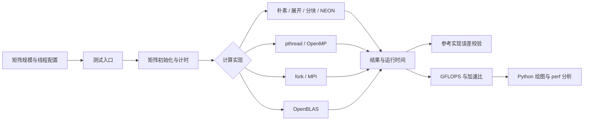
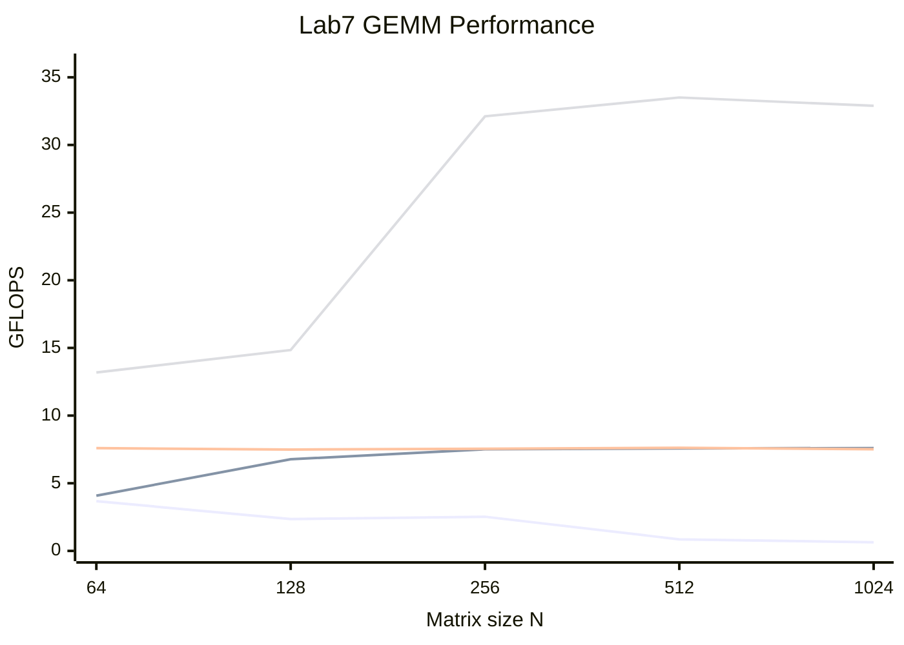

<div align="center">

<h1>High Performance Computing</h1>
<h3>高性能计算应用实践 · 2026 秋季</h3>
<p>从朴素矩阵乘法到并行计算与单核优化</p>


<p><a href="README.md">English</a> · <strong>简体中文</strong></p>

</div>

本仓库收录「高性能计算应用实践」课程 Lab1–Lab9 的源代码，围绕双精度矩阵乘法（DGEMM）学习编译优化、多进程、多线程、OpenMP、MPI、性能分析与单核优化。

## 实验目录

| 实验 | 内容 | 源代码目录 |
| --- | --- | --- |
| Lab1 | Linux C 编程、朴素 DGEMM 与 OpenBLAS、行列主序 | [Lab1/lab1](Lab1/lab1) |
| Lab2 | 浮点运算、编译优化、C/Python/NumPy/OpenBLAS 对比 | [Lab2](Lab2) |
| Lab3 | fork 多进程编程与矩阵乘法 | [Lab3](Lab3) |
| Lab4 | pthread 线程创建、参数传递与分块矩阵乘法 | [Lab4](Lab4) |
| Lab5 | OpenMP 并行循环、调度与矩阵乘法 | [Lab5](Lab5) |
| Lab6 | MPI 通信、π 计算与分布式矩阵乘法 | [Lab6/mpi](Lab6/mpi) |
| Lab7 | 朴素、pthread、OpenMP、OpenBLAS 实现对比 | [Lab7/gemm](Lab7/gemm) |
| Lab8 | GEMM 性能分析与 perf 测量入口 | [Lab8/how-to-optimize-gemm](Lab8/how-to-optimize-gemm) |
| Lab9 | 循环展开、ARM NEON 向量化、分块与组合优化 | [Lab9/how-to-optimize-gemm](Lab9/how-to-optimize-gemm) |

GEMM 框架中的 `test_MMult.c` 为测试入口，`REF_MMult.c` 提供参考实现，`util.c` 与 `defs.h` 提供公共函数和矩阵访问定义。`MMult*.c` 或按实现命名的文件提供 `MY_MMult`；`makefile` 中的 `NEW` 选择参与构建的版本。Python 脚本用于矩阵乘法对比和性能绘图。

## 实验原理

双精度矩阵乘法的基本形式为 $C = \alpha AB + \beta C$。对 $M\times K$ 和 $K\times N$ 的矩阵，主要浮点运算量约为 $2MNK$；采用 $\mathrm{GFLOPS}=2MNK/(t\times10^9)$ 衡量吞吐量。误差校验与性能测量分开进行，以减少参考实现对计时的干扰。

| 方法 | 原理 | 主要代价或适用条件 |
| --- | --- | --- |
| 朴素三重循环 | 逐元素计算点积，作为比较基线 | 行主序下按列访问 B 会产生跨步访存 |
| 编译优化与循环展开 | 改善寄存器分配、指令调度，减少循环控制开销 | 收益依赖编译器和内存访问模式 |
| 循环重排与分块 | 让内层连续访问 B/C，并复用缓存中的子矩阵 | 分块尺寸应匹配缓存和矩阵规模 |
| pthread / OpenMP | 按结果矩阵行划分任务，线程写入不同区域 | 小矩阵可能受线程创建、调度与同步开销影响 |
| fork / MPI | 以进程划分任务，通过进程通信分发和汇总结果 | 需计入通信与数据搬运成本 |
| NEON 与 FMA | 以 SIMD 指令并行处理双精度元素 | 跨步装载可能抵消向量化收益 |
| OpenBLAS | 使用优化库作为性能参照 | 线程数和底层 BLAS 配置会影响结果 |

## 系统架构

下图表示各实验的共同流程；fork、MPI 示例独立组织，GEMM 实验共享测试框架的接口约定。



## 编译与运行示例

在仓库根目录执行以下示例。各实验独立构建，矩阵规模、线程数与实现选项以各目录的源代码和 Makefile 为准。

### Lab1：DGEMM 对比

```bash
cd Lab1/lab1
gcc time_dgemm.c -o time_dgemm -lopenblas -lm
./time_dgemm 256
```

### Lab4 / Lab5：并行 GEMM

```bash
cd Lab4/how-to-optimize-gemm
make run NEW=multi_thread RUN_REF=1
```

```bash
cd Lab5/how-to-optimize-gemm
make run NEW=openmp RUN_REF=1
```

`RUN_REF=1` 启用参考实现校验；`RUN_REF=0` 用于只测目标实现。切换实现时应检查 Makefile 的编译和链接选项，例如 pthread 需要 `-pthread`，OpenMP 需要 `-fopenmp`，OpenBLAS 需要 `-lopenblas`。部分 Makefile 内部设置了 `OMP_NUM_THREADS`，调整线程数时应同步检查该设置。

### Lab6：MPI

```bash
cd Lab6/mpi
mpicc dgemm_mpi.c -o dgemm_mpi -lm
mpirun -np 4 ./dgemm_mpi
```

### Lab7：多种实现对比

```bash
cd Lab7/gemm
bash run.sh
python3 plotFlops.py
```

`run.sh` 构建并运行四种实现，先进行参考结果校验，再生成性能数据供绘图使用。

### Lab9：单核优化

```bash
cd Lab9/how-to-optimize-gemm
make run NEW=MMult_unroll8 OPT=-O2 RUN_REF=1
make run NEW=MMult_block OPT=-O2 RUN_REF=1
```

运行实验会生成 `_build/`、`_data/` 等本地输出。性能结果受处理器、编译器选项、矩阵规模和线程数影响，应在自己的环境重新测量。

## 实验结果与算法对比

以下结果摘自已有课程实验记录，并非本次上传重新运行所得。不同实验的机器和编译选项不同，仅在相同测试条件内比较；仓库提交源代码与脚本，测量文件和原始报告保留在本地。

### 多种实现对比：Lab7

实验记录中的参考矩阵规模为 $N=512$；pthread、OpenMP、OpenBLAS 使用 4 个线程。加速比按 C naive（O0）的 0.270 GFLOPS 重新计算。

| 实现 | GFLOPS | 相对 C naive（O0）加速比 |
| --- | ---: | ---: |
| Python naive | 0.00906 | 0.034× |
| C naive（O0） | 0.270 | 1.00× |
| C naive（O1） | 0.442 | 1.64× |
| C naive（O2） | 0.855 | 3.17× |
| C naive（O3） | 0.785 | 2.91× |
| pthread | 7.57 | 28.04× |
| OpenMP | 7.62 | 28.22× |
| OpenBLAS | 33.5 | 124.07× |
| Python NumPy | 30.3 | 112.22× |

### 性能曲线：矩阵规模与吞吐量

曲线采用 Lab7 本地测量输出中的实际数值，保留三位小数。四条曲线按 **C naive（O2）、pthread、OpenMP、OpenBLAS** 的顺序绘制，横轴为离散矩阵规模，纵轴为 GFLOPS。对应数值表用于明确各曲线所属实现。



| N | C naive（O2） | pthread | OpenMP | OpenBLAS |
| ---: | ---: | ---: | ---: | ---: |
| 64 | 3.677 | 4.084 | 7.592 | 13.182 |
| 128 | 2.354 | 6.771 | 7.492 | 14.846 |
| 256 | 2.526 | 7.507 | 7.552 | 32.113 |
| 512 | 0.855 | 7.570 | 7.619 | 33.508 |
| 1024 | 0.636 | 7.602 | 7.516 | 32.893 |

曲线中的 naive 由 `run.sh` 的 `-O2` 配置构建，与上表 O0 基线不同。随着矩阵规模增大，朴素实现吞吐量下降；pthread 与 OpenMP 在较大规模上接近 7.5 GFLOPS，OpenBLAS 约为 33 GFLOPS。

### 单核优化：Lab9

测试条件为 $N=512$、行主序、AArch64。各行保留原实验的编译条件，因此这些结果体现不同实现和编译配置的组合效果。

| 实现 / 配置 | GFLOPS | 相对基线 | 观察 |
| --- | ---: | ---: | --- |
| MMult0，`-O0` | 0.266 | 1.00× | 点积内层对 B 跨步访问 |
| 自动展开，`-O2 -funroll-loops` | 0.786 | 2.95× | 编译优化带来显著收益 |
| 手写 8 路展开，`-O0` | 0.387 | 1.45× | 局部累加和循环展开改善性能 |
| 自动向量化选项，`-O3 -ftree-vectorize` | 0.776 | 2.92× | 原优化报告显示目标循环实际未向量化 |
| 手动 NEON，`-O0` | 0.191 | 0.72× | 跨步装载开销抵消 SIMD 收益 |

综合优化版本 [MMult_combo.c](Lab9/how-to-optimize-gemm/MMult_combo.c) 结合 i-k-j 重排、分块和 NEON FMA。仅对 C 分块的记录显示不同块尺寸收益有限，应同时考虑 A/B 的访问与复用。

## 实验总结

1. **优先改善访存。** 循环重排和缓存复用决定 SIMD、展开与多线程能否发挥作用；手写向量化也可能比基线更慢。
2. **并行收益随问题规模变化。** 较大矩阵更容易摊薄线程启动和调度成本，pthread 与 OpenMP 在相同划分下表现接近。
3. **优化等级并非单调提升。** 本次 Lab7 的 O3 结果低于 O2，需要结合具体处理器和编译结果测量。
4. **统一比较口径。** 明确矩阵规模、线程数、编译选项、参考实现和计时边界；先验证正确性，再评估吞吐量。
5. **优化库提供有用的参照。** OpenBLAS 的结果体现分块、SIMD 和线程协同优化的价值。

## 环境配置

- Linux、GCC、GNU Make。
- OpenBLAS 开发库，用于调用 CBLAS。
- GCC OpenMP 支持及 pthread。
- Open MPI 或 MPICH，用于 Lab6 的 `mpicc` 和 `mpirun`。
- Python 3；运行 Python 对比和绘图脚本需要 NumPy、Matplotlib。
- 分析性能时可使用 Linux `perf`。

Lab9 的 `MMult_vec.c` 和 `MMult_combo.c` 使用 ARM NEON，需要支持对应指令的 AArch64 环境；其他版本的运行条件以源代码和编译选项为准。

建议复现实验时记录以下环境信息，并在同一环境下重复测量：

```bash
uname -a
lscpu
gcc --version
mpicc --version
python3 --version
```

可在虚拟环境中安装绘图依赖：

```bash
python3 -m venv .venv
source .venv/bin/activate
python3 -m pip install numpy matplotlib
```

## 参考资料

- [FLAME: How to Optimize GEMM](https://github.com/flame/how-to-optimize-gemm)：矩阵乘法优化教学示例。
- [GCC 优化选项](https://gcc.gnu.org/onlinedocs/gcc/Optimize-Options.html)：编译优化参数说明。
- [OpenMP 规范](https://www.openmp.org/specifications/)：共享内存并行 API。
- [Open MPI 文档](https://www.open-mpi.org/doc/)：MPI 程序编译和运行。

## 许可证

仓库沿用 [MIT License](LICENSE)。
